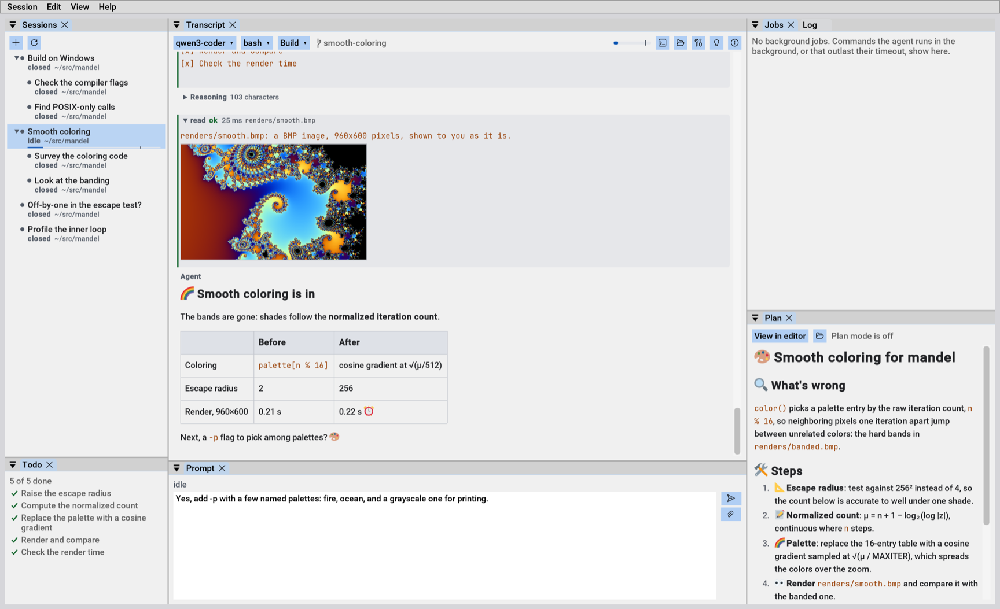

# Prospero: a bloat-free, native AI coding harness with ImGui

Prospero is a native GUI application for Windows, macOS, and Linux that
connects to an AI model provider, local or remote, allowing AI agents to
drive your computer to develop software. It plows through intermittent
errors and keeps at its task while unattended. It speaks the OpenAI Chat
Completions API, used by llama.cpp, vLLM, LiteLLM, and providers with a
compatible API. Also Anthropic's Messages API, with extended thinking and
prompt caching. No providers are configured out of the box.

The UI is highly flexible, and you can rearrange the panes as you please
with dragging and docking. Save your layouts for later in View -> Layouts.
Unlike conventional ImGui applications, rendering is passive and will not
consume resources while idle.

It is a single executable, written in C++. In the typical case the engine
runs in the same process as the window, and needs no daemon or server. The
same executable can run headless, on another machine over ssh, or in the
background after its window closes. The engine is lean and portable, and
runs on computers and operating systems a quarter century old. Imagine a
coding harness on Windows XP.

Once it's connected to a provider, **you can ask Prospero for help with
itself**. It will read its own embedded documentation, self-configure, and
navigate you to any place in its UI.

Prospero's desktop control features allow it to effectively develop, test,
and debug native GUI applications. On Windows, it especially works well in
[w64devkit][], making use of its shell and tools if available.

You can start new sessions from the command line, even if there's already
an instance, by invoking Prospero with a path where the new session will
be rooted. For example, to start a session here:

    $ prospero .

After no arguments, this is the second most common way to run Prospero.

## Documentation

- [Usage](docs/usage.md): running it, sessions, the GUI, attachments,
  modes and the command line
- [Configuration](docs/configuration.md): `prospero.ini`, endpoints,
  models, roles, instructions, skills, MCP servers and web search
- [Desktop control](docs/desktop.md): letting the agent see and drive
  the screen
- [Remote and background hosts](docs/remote.md): engines on other
  machines over ssh, and sessions that outlive the window
- [Windows notes](docs/windows.md)
- [Building](docs/building.md): building from source, and releases
- [Development](docs/development.md): tests, and evals for comparing
  models

Prospero also carries its own documentation, under Help, which an
agent in it can read too.

## License

Prospero is free and unencumbered software released into the public
domain. See [UNLICENSE](UNLICENSE).

Its programs include third-party code under its own licenses: Dear
ImGui (MIT), FreeType (FTL), md4c (MIT), SDL3 (zlib), cpp-httplib
(MIT), Mbed TLS (Apache-2.0), and Wuffs (Apache-2.0 or MIT, at your
option), which every program with the engine includes.

[w64devkit]: https://github.com/skeeto/w64devkit
